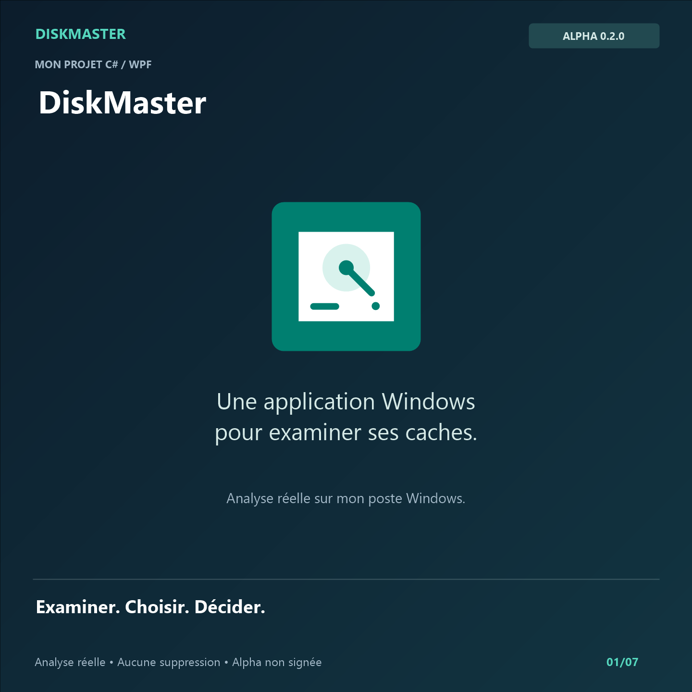

# Démonstration de DiskMaster

[Vidéo MP4](https://github.com/DjibrilKounta/DiskMaster/releases/download/v0.2.0-alpha.1/DiskMaster-demo-reelle-musique.mp4) · 46 secondes · 1440 × 1440 · sous-titres intégrés · musique de fond.

## Ce qui est montré

La vidéo est un montage de captures de l'interface réelle de DiskMaster 0.2.0-alpha.1, exécutée sur le profil Windows du mainteneur le 28 octobre 2026. Aucun service fictif n'est utilisé.

1. Présentation de l'application.
2. Analyse réelle des catégories du profil.
3. Résultats : 534 fichiers candidats, pour environ 2,02 Gio estimés.
4. Exclusion des rapports de plantage : 530 fichiers sélectionnés, environ 1,81 Gio.
5. Présentation du dialogue de confirmation, puis refus du nettoyage.
6. Rappel de la différence entre estimation et espace effectivement libéré.

L'analyse est partielle : deux éléments sont inaccessibles ou exclus, comme l'indique la catégorie temporaire. Les chiffres peuvent varier d'un poste ou d'une analyse à l'autre. Aucun fichier n'a été supprimé pendant la démonstration.

## Confidentialité

Le cadrage exclut les chemins du profil et les noms de fichiers personnels. Seuls le MP4 final et sa couverture sont publiés ; les captures brutes et les outils de montage restent dans le dossier local `artifacts`, ignoré par Git.

## Musique et statut du produit

La musique instrumentale a été composée pour ce montage à partir de sons synthétiques : accords, arpège, basse et percussion légère, à 88 BPM. Aucun morceau commercial ni échantillon tiers n'est utilisé.

La version montrée reste une alpha expérimentale non signée. Cette présentation ne constitue pas une qualification de production. Consulter le [guide utilisateur](USER-GUIDE.md), les [limites de sécurité](SECURITY-REVIEW.md) et la [checklist de livraison](RELEASE-CHECKLIST.md).
